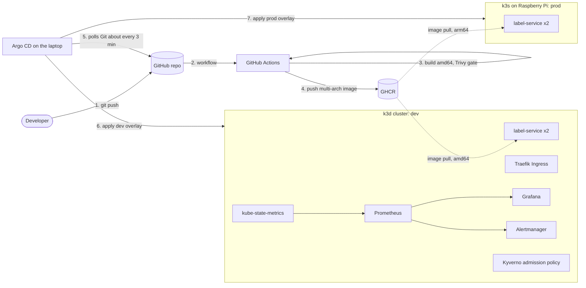

# k8s-platform-demo

A small multi-cluster Kubernetes platform, built to practice GitOps, CI/CD, supply-chain hygiene,
observability and policy-as-code. The demo workload is `label-service`, a Spring Boot REST API
that sets and reads product prices, inspired by electronic shelf label systems.

| | dev | prod |
|---|---|---|
| Cluster | k3d (3 nodes) on a laptop | k3s on a Raspberry Pi 4 (arm64) |
| Deployed by | Argo CD, follows `main` directly | Argo CD, changes only through a reviewed pull request |
| Ingress | Traefik, `label-service.localhost` | none (ports 80/443 are used by other services) |
| Monitoring and policy | Prometheus, Grafana, Alertmanager, Kyverno | not installed |

## Architecture



### Delivery flow

1. A push to `main` that touches `label-service/` starts the workflow.
2. The image is built for amd64 and scanned by Trivy. HIGH or CRITICAL findings with a fix fail the
   pipeline, so a vulnerable image never reaches the registry.
3. Only after the scan passes, a multi-arch image (amd64 and arm64) is pushed to GHCR with the tag
   `sha-<7 characters of the commit>`.
4. Argo CD compares Git with each cluster and applies the difference. Manual changes are reverted
   (self-heal).
5. **Promotion:** dev points at the new tag on `main`. Prod changes one line in
   `overlays/prod/kustomization.yaml` through a pull request, so every prod change has a diff, a
   review and an audit trail.

## Repository layout

```
label-service/            Spring Boot app, multi-stage Dockerfile (non-root)
k8s/label-service/base    Deployment, Service (probes, requests, limits)
k8s/label-service/overlays/dev|prod
                          Kustomize overlays: image tag, replicas, ConfigMap values, dev Ingress
k8s/monitoring/           kube-prometheus-stack values and a PrometheusRule alert
k8s/policies/             Kyverno values and a ValidatingPolicy
argocd/                   Argo CD Applications and prod cluster access
scripts/                  Helper to register the prod cluster in Argo CD
.github/workflows/        CI: build, scan, push
manifests/                Plain manifests from the first learning steps
```

## Configuration and secrets

- Behaviour that differs per environment (`APP_ENVIRONMENT`, `APP_DEFAULT_CURRENCY`) comes from a
  ConfigMap that Kustomize generates per overlay. The image is identical on dev and prod.
- `APP_API_KEY` comes from a Secret that is created by hand on each cluster and is never in Git.
  Write endpoints are protected by it. `GET /api/info` shows the environment and whether writes are
  protected, never the key.
- Known gap: a rebuilt cluster loses that Secret. The next step would be SOPS (encrypted file in
  Git) or External Secrets Operator (values in a vault, Git holds only a pointer).

## Observability

- `kube-prometheus-stack` is installed with Helm on dev (`k8s/monitoring/`), kept small for a laptop.
- Alert `LabelServiceReplicasUnavailable` fires when fewer replicas are available than wanted, or
  none at all, for one minute. It was tested by pausing Argo CD auto-sync and scaling the
  Deployment to 0. The first version missed scale-to-zero, because scaling also lowers the desired
  count, so the rule now has a second condition.

## Policy as code

Kyverno 1.20 runs on dev with a `ValidatingPolicy` (CEL) named `require-memory-limits`. In the
namespace `label-service`, a Pod whose containers do not all set `resources.limits.memory` is
rejected at admission. Other namespaces are not affected.

```bash
# rejected
kubectl -n label-service run bad --image=nginx --dry-run=server
```

## Try it

Prerequisites: Docker, kubectl, k3d, Helm.

```bash
k3d cluster create dev --servers 1 --agents 2 -p "8080:80@loadbalancer"
# Install Argo CD, then apply the Applications:
kubectl apply -f argocd/apps/label-service-dev.yaml
# After the first sync Argo CD has created the namespace. Create the Secret the app expects (any random value):
kubectl -n label-service create secret generic label-service-secret \
  --from-literal=APP_API_KEY="$(openssl rand -hex 16)"
curl -s http://label-service.localhost:8080/api/info
```

Monitoring and policy:

```bash
helm repo add prometheus-community https://prometheus-community.github.io/helm-charts
helm upgrade --install kps prometheus-community/kube-prometheus-stack \
  -n monitoring --create-namespace -f k8s/monitoring/kube-prometheus-stack-values.yaml
kubectl apply -f k8s/monitoring/label-service-alerts.yaml

helm repo add kyverno https://kyverno.github.io/kyverno/
helm upgrade --install kyverno kyverno/kyverno \
  -n kyverno --create-namespace -f k8s/policies/kyverno-values.yaml
kubectl apply -f k8s/policies/require-memory-limits.yaml
```

## Decisions and trade-offs

- **GitHub Actions and GHCR instead of a self-hosted registry.** The Pi should not build images, and
  a registry over plain HTTP needs insecure-registry settings on every node.
- **Trivy action pinned to a commit SHA.** A tag can be moved, a commit cannot.
- **Prod without Ingress.** Traefik and servicelb are disabled on the Pi, because the host already
  uses ports 80 and 443.
- **Argo CD runs on the laptop and manages the Pi** through a ServiceAccount token. It has
  cluster-admin today. The next step is an AppProject for prod and a ServiceAccount limited to
  its namespaces.
- **Version skew:** dev runs k3s v1.35, prod runs v1.37. Worth aligning.

## Not done yet

- Secrets management (SOPS or External Secrets)
- Argo CD RBAC and AppProjects
- Monitoring and policies on prod
- Logs and traces (for example Loki, OpenTelemetry)
- cert-manager and external-dns
- Terraform or OpenTofu for the clusters
- Backups for stateful parts (the service keeps prices in memory only)
